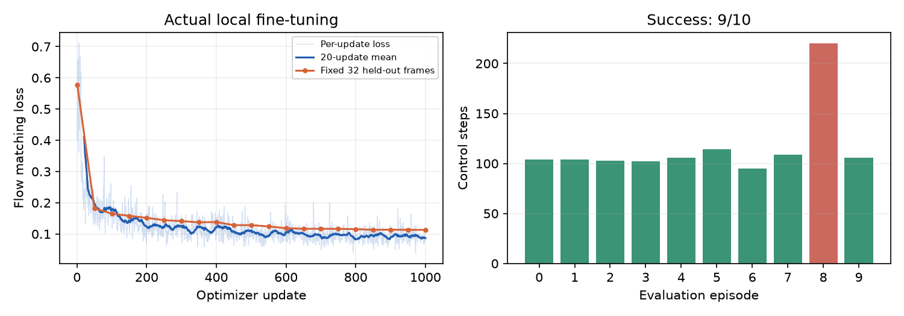

# SmolVLA LIBERO 单任务微调与评测

基于 LeRobot SmolVLA 与 LIBERO 的仿真实验：从双相机 RGB、八维机器人本体状态和英语任务指令生成七维末端动作，把饼干盒旁的黑碗放到盘子上。

本仓库提供数据适配、微调、评测和审计代码，以及本地实验记录。代码由 Codex 协助完成；使用官方策略及预训练模型，没有从零训练视觉语言基础模型，也未部署真机。

## 演示与实测

[模型自主成功视频](results/model-demo.mp4) · [失败视频](results/model-failure.mp4)

| 配置或测试 | 实际记录 |
|---|---|
| 数据 | 46条示范，38条训练、8条验证 |
| 更新预算 | 1000次，batch=8，单训练种子 |
| 模型 | 约450M参数；冻结VLM，更新约99.9M参数 |
| 正式评测 | 初始状态0—9，9/10成功 |
| 额外开发条件 | 初始状态40—42，1/3成功 |
| 相同前三条件对照 | 微调前0/3，微调后3/3 |

这是单任务小样本结果，不是完整 LIBERO 基准；未证明测试布局与全部示范完全独立，也未验证任意指令泛化。详见 [实验报告](results/实验报告.md) 和 [逐回合记录](results/evaluation-step1000/episodes.json)。

## 复现与代码入口

权重、优化器、原始数据、解码帧及上游源码未上传，需下载预训练模型和公开数据，再执行微调；没有提供已训练模型下载链接。

1. 在 Windows + WSL Ubuntu 24.04 或 Linux 中准备 Python 3.12、uv 和图形依赖。
2. 按 `sources.json` 的提交号克隆 [LeRobot](https://github.com/huggingface/lerobot) 到 `official/lerobot`，克隆 [LIBERO](https://github.com/Lifelong-Robot-Learning/LIBERO) 到 `official/LIBERO` 并切换对应提交。
3. 阅读 [本机运行说明](docs/local-experiment.md)，调整 `scripts/setup.sh`、`common.sh` 的本机 uv、WSLg/D3D12、缓存和暂存路径。安装脚本依赖既有环境，不是全新系统一键安装器。
4. 依次运行 `run.ps1 -Task setup`、`download`、`prepare`、`train`；生成检查点后执行 `audit`、`evaluate`。精确配置和结果边界见本机说明。

主要实现：`scripts/data_pipeline.py`、`train.py`、`evaluate.py`、`environment.py`、`policy_utils.py`；契约测试在 `tests/`。来源、许可证与贡献边界见 [THIRD_PARTY.md](THIRD_PARTY.md)。

