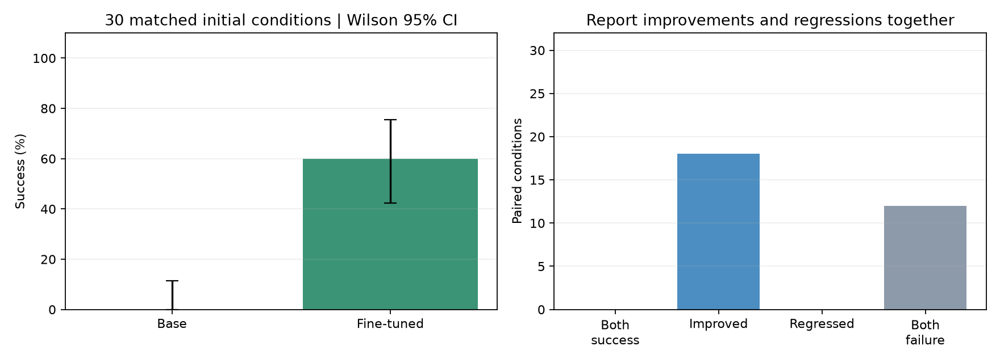

# SmolVLA 新增30个初始条件配对评测

日期：2026-10-21。固定已保存的基座与1000步微调模型，不重训。使用官方初始状态10—39、种子3000—3029，两个模型逐一配对。旧正式0—9与开发40—42的成绩不合并进本轮。

成功沿用原LIBERO任务判据，没有额外要求夹爪退出或长时间稳定；不能与ACT项目更严格的放置判据直接比较成功率。

## 完整成绩

| 模型 | 成功次数 | Wilson 95%区间 | 全部回合平均步数 | 成功回合平均步数 |
|---|---:|---|---:|---:|
| 基座模型 | 0/30 | 0.0%—11.4% | 220.0 | — |
| 微调模型 | 18/30 | 42.3%—75.4% | 155.7 | 112.8 |

微调相对基座成功率差为60.0个百分点。全部回合均值将失败计为220步，因此受到超时截断影响；成功回合均值只描述各自成功子集，不能当作同一任务集合上的模型速度比较。

| 配对结果 | 个数 |
|---|---:|
| 两模型都成功 | 0 |
| 基座失败、微调成功 | 18 |
| 基座成功、微调失败 | 0 |
| 两模型都失败 | 12 |

## 可核验的案例

各类按初始状态从小到大选择第一个回合，未根据展示效果挑选。

- improved：初始状态10，seed3000；[基座视频](base/episode_00.mp4)、[微调视频](finetuned/episode_00.mp4)。
- both_failure：初始状态11，seed3001；[基座视频](base/episode_01.mp4)、[微调视频](finetuned/episode_01.mp4)。

完整配对清单见[逐回合CSV](paired-episodes.csv)，全部摘要、视频/轨迹指纹见[审计JSON](paired-summary.json)。每组保留所有视频及逐步动作、本体状态轨迹；基座与微调分别使用同一输入输出适配和训练集统计量。

## 结论边界

这轮补充回答“在新增官方初始条件中，现有微调是否比基座更有效”，不证明任意布局、多任务、语言理解或真机能力。RLDS示范与官方初始状态映射仍缺失，不能称为严格训练未见布局测试。60次执行对应30个条件，不是60个独立场景；每条件只有一个推理种子，也没有覆盖训练随机性。

Wilson区间按二项抽样作近似描述；本轮使用固定的官方初始条件子集，并非对所有场景的随机抽样，因此区间不能保证总体泛化覆盖，也不覆盖训练随机性。

此前9/10正式成绩和1/3开发成绩保留；本轮应与它们分别报告。不会从这30个条件中挑选成功子集重新计算，也不使用本轮结果选择新模型后继续当作独立测试。

本轮数据与动作契约测试7项通过；模型、统计量、配置、评测源码和历史成绩指纹在运行前后保持一致。原评测器未改动。协议见项目docs/paired-evaluation-protocol.md，输入指纹见input-fingerprints.json。
